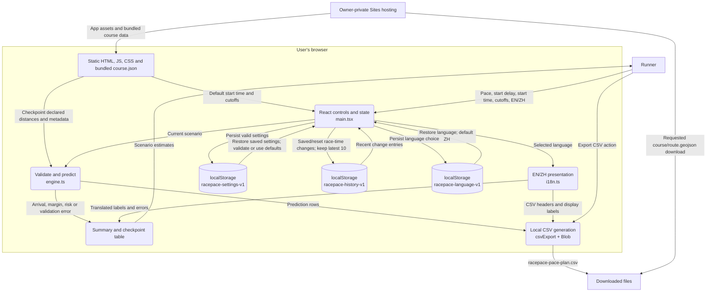
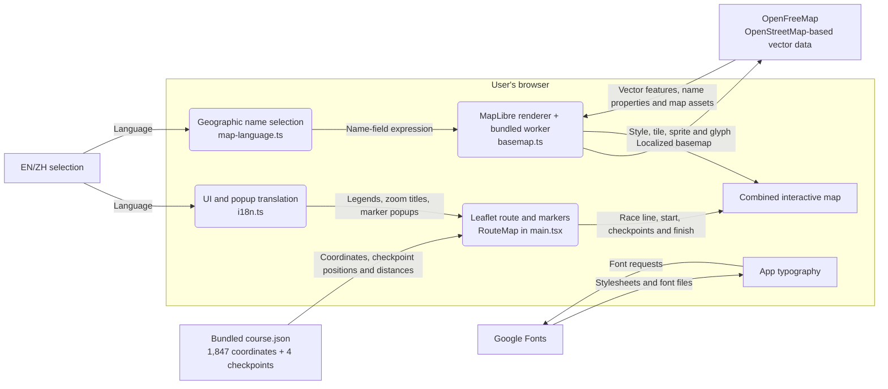
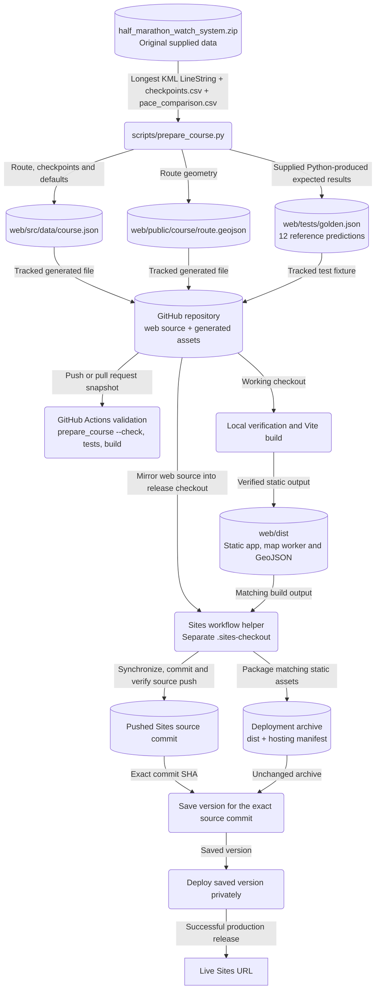
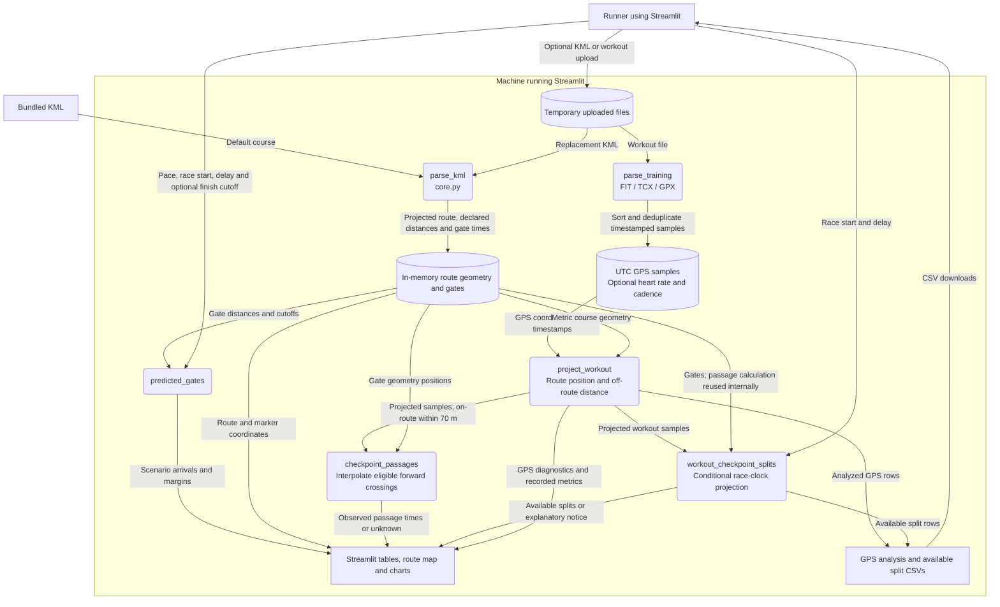

# Data flow diagram

RacePace · current implementation as of 2026-10-17.

The deployed site is a static React app: pace calculations and settings storage run in the user's browser. The repository also retains a separate Python/Streamlit prototype with workout analysis. The diagrams below describe the implemented flows; the broader [system design](../RacePace_SYSTEM_DESIGN_v1.md) includes future work.

Arrows show the data being transferred. Rounded nodes are processing steps, cylinders are data stores, and rectangular nodes are inputs, outputs or external services. Mermaid diagrams render directly on GitHub.

## 1. Deployed web app: pace planning



The prediction engine uses these values, all in seconds except distance:

```text
elapsed = declaredKm × paceSecondsPerKm
arrival = startSeconds + delayMinutes × 60 + elapsed
margin  = cutoffSeconds − arrival
```

Risk is `safe` at ≥600 seconds, `watch` at 300–599, `tight` at 0–299, and `late` below 0. Calculations use unrounded values; displayed clock times truncate fractional seconds. Race times are Asia/Taipei wall-clock values for a single race day.

The KML geometry length (~21.719 km) is separate from the declared race distance (21.0975 km). Geometry does **not** determine pace predictions. Invalid settings display an error and are not persisted; the CSV button is disabled when there are no valid prediction rows. Storage failures leave the app usable for the current session.

## 2. Deployed web app: map and language



English prefers `name:en`, `name_en`, then `name:latin`; Chinese prefers `name:zh-Hant`, `name:zh_TW`, then `name:zh`. Both fall back to the source `name` when translations are missing. Road numbers and other non-name labels remain unchanged. Switching language updates the existing map, preserving its view and route overlay.

The renderer loads separately from the main application. A basemap loading error shows a localized notice; the Leaflet race overlay remains available. External map/font requests are part of the runtime flow, but the app does not send pace settings, change history or workout files to these services.

## 3. Course preparation, validation and publication



`prepare_course.py` reads the original ZIP directly, not the extracted files in `data/fixtures/` or `legacy-python/`. It takes checkpoint distances from the supplied CSV rather than recalculating them. `--check` compares the generated content with the tracked files without changing them. Tests compare the TypeScript predictions with the 12 supplied reference results and validate language-selection behavior.

GitHub CI validates the repo; it does not deploy. Sites publication uses a separate source history, a matching build archive and a saved version. GitHub pushes alone do not update the live site. See [deployment notes](DEPLOYMENT.md) for release identifiers and the publication procedure.

## 4. Legacy Python prototype: workout analysis

This flow runs only when the original Streamlit application is started separately. It is not part of the deployed React app.



Uploads are written to temporary files on the machine running Streamlit. Parsing normalizes timestamps to UTC. GPS matching uses projected metric geometry; eligible crossings require nearby, forward-moving samples within the code's time/distance thresholds. Split projection requires the first on-route sample to be within the first 0.10 km of the course and stops at the first unknown checkpoint. This remains prototype matching and can be ambiguous on loops or nearby parallel streets.

The live web app currently has an import placeholder only. Workout parsing, GPS matching, durable workout history, D1/R2 storage and application-level multi-user accounts are future migration work, not active web data flows.

## Source references

| Responsibility | Implementation |
| --- | --- |
| UI state, local storage, map overlay and downloads | [main.tsx](../web/src/main.tsx) |
| Validation, pace predictions and CSV encoding | [engine.ts](../web/src/engine.ts) |
| Interface translations | [i18n.ts](../web/src/i18n.ts) |
| Vector basemap and name selection | [basemap.ts](../web/src/basemap.ts), [map-language.ts](../web/src/map-language.ts) |
| Deterministic course asset generation | [prepare_course.py](../scripts/prepare_course.py) |
| Validation workflow | [ci.yml](../.github/workflows/ci.yml) |
| Hosting configuration | [hosting.json](../web/.openai/hosting.json) |
| Original workout processing | [app.py](../legacy-python/app.py), [core.py](../legacy-python/core.py) |
